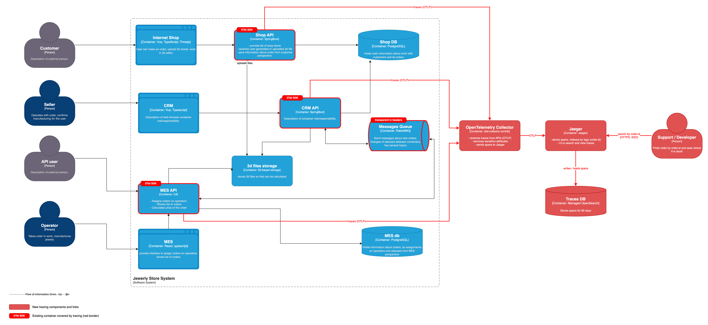
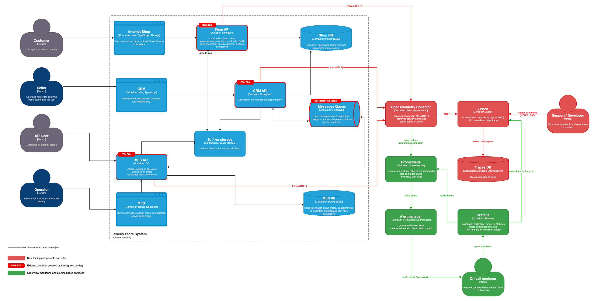

# Архитектурное решение по трейсингу

## 1. Анализ: где заказ может сломаться или зависнуть

Как сейчас идёт заказ (по схеме):

- **Из магазина.** Покупатель создаёт заказ в Internet Shop. Shop API сохраняет его в Shop DB, файл кладёт в S3 (INITIATED → FILE_UPLOADED → SUBMITTED). CRM API видит заказ в общей Shop DB и отправляет его в MES через RabbitMQ. MES API считает цену и отправляет PRICE_CALCULATED обратно в CRM. Продавец подтверждает заказ (MANUFACTURING_APPROVED), сообщение уходит в MES. Оператор проводит заказ по статусам до SHIPPED, каждый статус уходит в CRM через RabbitMQ. CRM закрывает заказ (CLOSED).
- **От партнёра.** API user вызывает MES API, MES считает цену и через RabbitMQ отправляет заказ в CRM, где он создаётся.

Места, где заказ может сломаться или зависнуть:

| № | Где | Что может пойти не так |
|---|---|---|
| 1 | Shop API → S3 | Файл 3D-модели не загрузился или загрузился битым. Цену потом не посчитать |
| 2 | Shop DB → CRM API | Заказ SUBMITTED лежит в общей базе, а CRM его не подхватил. Явного события нет, никто об этом не узнает |
| 3 | CRM API → RabbitMQ → MES API | Сообщение о новом заказе потерялось, упало при обработке или висит без подтверждения. DLQ нет |
| 4 | Расчёт цены в MES API | Расчёт идёт 2–30 минут на единственном инстансе, может упасть или не закончиться |
| 5 | API user → MES API | Партнёр ждёт расчёта в синхронном запросе и получает таймаут. Он не знает, создан заказ или нет |
| 6 | MES API → RabbitMQ → CRM API | Потерялось сообщение со статусом или о новом заказе партнёра. Если потерялся PRICE_CALCULATED, продавец не увидит заказ и не подтвердит его — заказ висит, пока клиент не пожалуется. Очень похоже на «работают уже несколько месяцев» |
| 7 | CRM API → RabbitMQ → MES API | Потерялось подтверждение MANUFACTURING_APPROVED. Оператор не видит заказ, хотя продавец его подтвердил |
| 8 | MES API → MES DB | Медленные запросы дашборда, оператор поздно видит новые заказы |

Видно, что почти все проблемы — на стыках систем, а не внутри одной из них. Поэтому трейсинг нужен там, где заказ переходит из системы в систему.

Что покрываем трейсингом (на схеме — красная рамка и метка «OTel SDK»):

- **Shop API, CRM API, MES API** — здесь меняются статусы, отсюда отправляются и здесь принимаются сообщения. Это основное.
- **RabbitMQ** — сам брокер не трейсим, но передаём контекст трейса в заголовках сообщений. По спанам «отправил» и «обработал» видно, где сообщение пропало.
- **Shop DB, MES DB, S3** — отдельно не трейсим. Запросы к ним видны как дочерние спаны внутри API (их создаёт автоинструментация JDBC, Npgsql и S3-клиента).
- **Фронтенды** (Internet Shop, CRM, MES) — на первом этапе не трейсим (см. «Компромиссы»).

## 2. Какие данные попадают в трейсинг

**Технические данные (заполняются автоматически):**

- trace_id, span_id, parent span id, время начала и длительность;
- service.name (shop-api, crm-api, mes-api), service.version, deployment.environment (dev, release, prod);
- статус спана (OK / ERROR), тип и текст ошибки.

**Бизнес-данные (добавляем сами, это главное):**

- order.id — номер заказа. По нему ищем все трейсы одного заказа;
- order.status — статус заказа. При смене статуса пишем событие order.status_changed со старым и новым статусом;
- order.source — откуда заказ: shop или api;
- partner.id — для заказов от партнёров;
- customer.id — только внутренний id, без имени и контактов.

**По типам операций:**

- HTTP: метод, маршрут в виде шаблона (`/orders/{id}`), код ответа;
- RabbitMQ: exchange, очередь / routing key, message id, операция (publish / process), признак повторной доставки, результат (ack, nack, ушло в DLQ);
- БД: тип базы, операция и таблица (`SELECT orders`), без значений параметров;
- S3: операция (put / get), bucket, размер файла;
- расчёт цены: отдельный спан calculate_price — количество полигонов, длительность, результат (посчитано / ошибка / таймаут).

**Что не пишем никогда:** ФИО, телефоны, e-mail, адреса, токены и заголовок Authorization, тела запросов, содержимое 3D-файлов, значения параметров SQL.

## 3. Мотивация

Сейчас никто не может быстро ответить на вопрос «где мой заказ?». Статусы меняются в трёх системах, между ними RabbitMQ и общая база. Если сообщение потерялось, следов не остаётся. Разбор жалобы — это ручной поиск по трём базам, и причину часто так и не находят.

Что даст трейсинг:

- По номеру заказа видна вся его история: какой сервис что сделал, сколько это заняло и где цепочка оборвалась.
- Видны потерянные сообщения: есть спан отправки в RabbitMQ, но нет спана обработки.
- Видно, что тормозит: расчёт цены, база или ожидание в очереди.
- Поддержка отвечает клиенту и партнёру по фактам, а не «разберёмся и вернёмся».
- Разработчики чинят причину, а не гадают.

Метрики, на которые повлияет трейсинг:

| Метрика | Тип | Что изменится |
|---|---|---|
| Время разбора жалобы на заказ | Техническая | Сейчас часы и дни ручного поиска. С трейсингом — минуты: ищем по order.id в Jaeger |
| Количество «потерянных» заказов | Техническая | Видим каждый обрыв цепочки и чиним причину. Цель — ноль |
| Время прохождения заказа по шагам | Техническая | Видно, сколько заказ ждёт в очереди, в расчёте цены, в ожидании подтверждения. От этого считаем, что ускорять |
| Доля заказов, выполненных в срок (3 недели) | Бизнес | Растёт: зависший заказ находим сразу, а не после жалобы |
| Количество жалоб клиентов и партнёров | Бизнес | Снижается, а с ним риск потерять ещё один крупный контракт |

## 4. Предлагаемое решение

### 4.1. Технологии

- **OpenTelemetry** — стандарт и SDK для сбора трейсов. Бесплатный, есть для Java и .NET, не привязывает нас к вендору.
- **OpenTelemetry Collector** — принимает трейсы от сервисов, вырезает чувствительные данные и отправляет дальше.
- **Jaeger** — хранение и UI для поиска трейсов. Open source, умеет искать по тегам, то есть по order.id.
- **Хранилище для Jaeger** — Managed OpenSearch в Yandex Cloud (у нас базы уже в managed-сервисах). Храним трейсы 90 дней: заказ живёт несколько недель, а жалоба может прийти и позже. Тот же кластер потом можно использовать для логов (задание 4).

### 4.2. Что внедряем и дорабатываем

1. **Shop API и CRM API (Spring Boot).** Подключаем OpenTelemetry Java agent при запуске (`-javaagent:opentelemetry-javaagent.jar`). Он сам создаёт спаны для HTTP, JDBC, RabbitMQ и S3 и сам кладёт контекст трейса в заголовки сообщений RabbitMQ. В код добавляем только атрибут order.id и событие смены статуса.
2. **MES API (C#).** Подключаем пакеты OpenTelemetry для .NET (ASP.NET Core, HttpClient, Npgsql). Передачу контекста через RabbitMQ делаем в общем месте отправки и чтения сообщений: при отправке кладём `traceparent` в заголовки, при чтении достаём. Это несколько строк кода, а в RabbitMQ.Client 7 это уже есть из коробки. Добавляем спан calculate_price вокруг расчёта цены и атрибуты order.id, partner.id.
3. **Связка через Shop DB.** CRM читает заказ из общей базы, и контекст трейса тут сам не передаётся. Не усложняем: обе стороны пишут order.id, и все трейсы заказа находятся поиском по нему.
4. **OpenTelemetry Collector и Jaeger** — в Docker на отдельной ВМ (можно на той же, что и мониторинг из задания 2). Хранилище — Managed OpenSearch.
5. **Настройки Collector:** батчинг, удаление чувствительных атрибутов, отбрасываем health-check запросы. Сэмплинг 100%: заказов немного (сотни–тысячи в месяц), объём маленький. А пропущенный трейс — это как раз тот заказ, который мы потом будем искать.
6. **Порядок внедрения:** dev → release → prod. На release проверяем, что нагрузка на MES API выросла не больше чем на несколько процентов.

### 4.3. Как это работает

Один заказ живёт неделями, поэтому один трейс на весь путь не делаем. Каждое техническое действие — запрос, обработка сообщения, расчёт цены — это свой трейс. Внутри действия контекст передаётся между сервисами через HTTP-заголовки и заголовки сообщений RabbitMQ (W3C `traceparent`). Поэтому цепочка «CRM отправил → MES получил → MES посчитал цену → MES отправил статус → CRM получил» видна одним трейсом. Все трейсы одного заказа связывает order.id.

Пример. Поддержка ищет в Jaeger `order.id=12345` и видит: заказ SUBMITTED в Shop API, CRM отправил его в MES, MES посчитал цену за 25 минут и отправил PRICE_CALCULATED в RabbitMQ — и дальше ничего, спана обработки в CRM API нет. Значит, сообщение потерялось между MES и CRM, и продавец этот заказ просто не видит.

### 4.4. Схема

Новые компоненты и связи выделены красным. Красная рамка и метка «OTel SDK» — существующие системы, которые покрываем трейсингом.

Ссылка на схему: [tracing_c4.drawio.png](tracing_c4.drawio.png) (исходник — [tracing_c4.drawio](tracing_c4.drawio)).

### 4.5. Дополнительно: автоматический мониторинг прохождения заказа и алертинг

Идея простая: не смотреть трейсы глазами, а считать из них метрики и ставить на них алерты.

- В OpenTelemetry Collector включаем **spanmetrics connector**. Он считает из спанов количество вызовов, ошибки и длительность по сервисам и операциям и отдаёт это в **Prometheus** (тот же, что в задании 2).
- Смену статуса пишем отдельным спаном order.status_changed с атрибутом order.status. Тогда в Prometheus появляется счётчик «сколько заказов перешло в каждый статус». В метрики попадает только статус (10 значений), order.id остаётся только в трейсах — иначе Prometheus раздуется.
- **Grafana:** дашборд «Прохождение заказа» — воронка по статусам, ошибки и длительность по шагам. С графика по ссылке (exemplar с trace_id) переходим сразу в нужный трейс в Jaeger.
- **Alertmanager** отправляет алерты в чат команды, критичные — звонком дежурному.

Алерты:

| Алерт | Условие | Что делаем |
|---|---|---|
| Сообщения теряются | За 30 минут сообщений в очередь отправлено заметно больше, чем обработано | Чат и тикет, смотрим трейсы по этой очереди |
| Расчёт цены не идёт | Новые заказы приходят, а PRICE_CALCULATED нет больше часа | Звонок дежурному |
| Расчёт цены медленный | p95 calculate_price больше 30 минут | Чат и тикет |
| Ошибки в сервисе | Доля спанов с ERROR больше 1% за 5 минут | Звонок дежурному |
| Сообщение ушло в DLQ | Хотя бы одно | Чат и тикет, поддержка проверяет заказ |

Дежурный получает алерт, открывает дашборд в Grafana и оттуда переходит в трейс конкретного заказа.

Новые элементы выделены зелёным:

Ссылка на схему: [tracing_alerting_c4.drawio.png](tracing_alerting_c4.drawio.png) (исходник — [tracing_alerting_c4.drawio](tracing_alerting_c4.drawio)).

## 5. Компромиссы

- **Весь путь заказа одним трейсом не увидим.** Заказ живёт неделями, а между шагами работают люди: продавец подтверждает, оператор делает изделие. Это не трейсится, видно только момент смены статуса. Поэтому трейсы склеиваем по order.id.
- **MES — купленная система.** Исходники есть, но дорабатывать её будет один C#-разработчик. Это 1–2 недели работы и риск конфликтов, если поставщик выпустит обновление. Поэтому в MES — автоинструментация и минимум ручных спанов.
- **Внутри расчёта цены — один спан.** Что происходит внутри расчёта, не видно без глубокой доработки MES. Пока хватает общей длительности и результата.
- **Связка Shop → CRM через общую базу.** Контекст трейса здесь не передаётся. Можно хранить `traceparent` в таблице заказов, но пока хватает поиска по order.id.
- **Внешние системы.** Сторону партнёров (API users) и транспортной компании не видим. Трейс начинается на входе в MES API или CRM API.
- **Фронтенды пока не трейсим.** Ошибки в браузере не увидим, но заказы теряются не там. Вернёмся к этому, если понадобится.
- **Накладные расходы.** Агент добавляет немного CPU и памяти. MES API и так перегружен, поэтому сначала проверяем на release.
- **Стоимость хранения.** 100% трейсов за 90 дней сейчас стоит недорого. Если заказов станет в разы больше, включим сэмплинг: храним все ошибки и медленные трейсы, остальное частично. Тогда поиск по order.id будет находить не все трейсы.
- **Трейсинг не заменяет логи и метрики.** Он показывает, где сломалось, а почему — часто видно только в логах (задание 4).

## 6. Безопасность

- **Нет доступа из интернета.** Jaeger UI, Grafana и Collector доступны только из внутренней сети или через корпоративный VPN.
- **Аутентификация.** У Jaeger нет своей авторизации, поэтому ставим перед ним oauth2-proxy с корпоративным SSO. Зайти могут только сотрудники с актуальной учётной записью и ролью «Поддержка», «Разработчик» или «DevOps». Продавцам, операторам и партнёрам доступа нет. Сотрудник уволился — учётку отключили, доступ пропал.
- **Права.** «Поддержка» и «Разработчик» только смотрят трейсы. Настройки Collector, Jaeger и хранилища меняет только DevOps.
- **Кто может отправлять трейсы.** Security group в Yandex Cloud пускает на порты Collector (OTLP 4317/4318) только ВМ Shop API, CRM API и MES API. Связь по TLS.
- **Хранилище.** OpenSearch доступен только сервисному аккаунту Jaeger. Данные шифруются на диске (managed-сервис), трейсы старше 90 дней удаляются автоматически.
- **Чувствительные данные.** Персональные данные в трейсы не пишем (список в разделе 2). Collector дополнительно вырезает заголовки Authorization и Cookie, query-параметры и значения SQL — на случай, если кто-то из разработчиков ошибётся.
- **Снаружи.** Партнёрам трейсинг не открываем. Входящий `traceparent` от партнёров не используем как родительский, начинаем свой трейс — чтобы чужая система не могла подмешать данные в наши трейсы. Наружу отдаём только номер заказа, по нему поддержка и находит трейс.
- **Аудит.** oauth2-proxy пишет, кто и когда заходил в Jaeger. Раз в квартал проверяем список пользователей с доступом.
