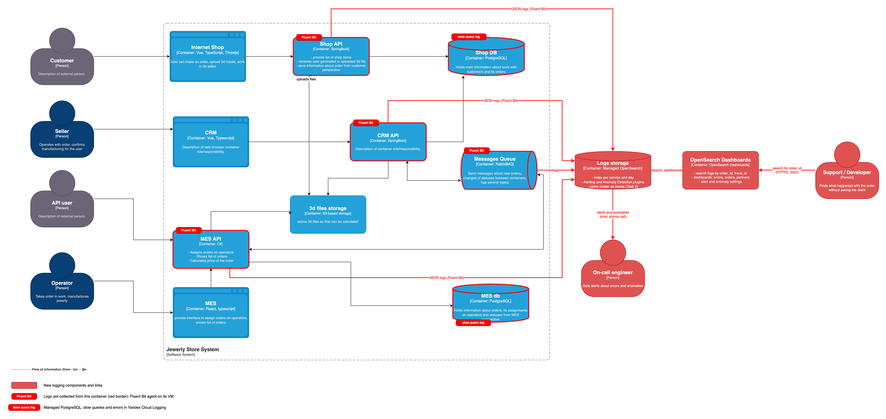

# Архитектурное решение по логированию

## 1. Анализ: какие логи собираем и откуда

Сейчас централизованных логов нет. Если что-то и пишется, то на диск каждой ВМ отдельно: чтобы разобраться, надо заходить по SSH на три машины и сопоставлять записи вручную. Поэтому проблемы и разбирают со слов клиента.

Откуда собираем логи (на схеме — красная рамка и метка):

| Система | Что собираем | Как |
|---|---|---|
| Shop API | Логи приложения: запросы, создание заказа, загрузка файлов, ошибки | Fluent Bit на ВМ |
| CRM API | Логи приложения: смена статусов, подтверждение продавцом, отправка и получение сообщений, ошибки | Fluent Bit на ВМ |
| MES API | Логи приложения: запросы партнёров, расчёт цены, действия операторов, сообщения, ошибки | Fluent Bit на ВМ |
| RabbitMQ | Логи брокера: подключение и отключение consumers, ошибки каналов, нехватка памяти и диска | Fluent Bit на ВМ |
| Shop DB, MES DB | Медленные запросы (дольше 1 секунды) и ошибки | Настройка managed PostgreSQL, логи в Yandex Cloud Logging |

Не собираем: S3 (сейчас там нечего разбирать) и фронтенды (см. раздел 3).

Схема — в разделе 4.3.

### 1.1. Логи уровня INFO

В каждой записи есть общие поля: время, уровень, сервис, окружение (dev, release, prod), версия, trace_id и span_id (связь с трейсингом из задания 3) и order_id, если запись относится к заказу.

| Событие | Где | Что пишем |
|---|---|---|
| Смена статуса заказа | Shop API, CRM API, MES API | order_id, старый и новый статус, кто изменил (customer_id, seller_id, operator_id или «system»), источник заказа (shop / api) |
| Заказ от партнёра принят | MES API | order_id, partner_id |
| Файл 3D-модели загружен | Shop API | order_id, ключ файла в S3, размер |
| Расчёт цены начат и закончен | MES API | order_id, количество полигонов, длительность, цена |
| Сообщение отправлено в RabbitMQ | CRM API, MES API | order_id, message_id, тип сообщения, очередь |
| Сообщение получено и обработано | CRM API, MES API | order_id, message_id, очередь, время обработки |
| Оператор взял заказ в работу | MES API | order_id, operator_id. Нужно для споров о вознаграждении: кто взял заказ, тот и получает оплату |
| Заказ закрыт | CRM API | order_id, причина: сообщение транспортной компании или вручную (seller_id) |
| HTTP-запрос к API | Все API | Метод, маршрут (`/orders/{id}`), код ответа, время ответа, partner_id или user_id |
| Запуск и остановка сервиса | Все API | Версия, окружение |
| Consumer подключился или отключился | RabbitMQ | Очередь, имя подключения |

### 1.2. Другие уровни

- **ERROR** — пишем всегда, во всех окружениях. Исключения, ответы 5xx, сообщение не обработалось или ушло в DLQ, расчёт цены упал, нет связи с базой, S3 или RabbitMQ. В записи — stack trace, order_id, message_id.
- **WARN** — пишем всегда. Повторная доставка сообщения, повторная попытка (retry), расчёт цены дольше 30 минут, запрос дольше 5 секунд, партнёр шлёт некорректные запросы (4xx), у RabbitMQ заканчивается память или диск.
- **DEBUG** — включён в dev и release, в prod выключен. В prod включаем временно, для одного сервиса, когда разбираем конкретную проблему (в Spring Boot через `/actuator/loggers`, в MES — сменой уровня в конфиге). Потом выключаем.
- **TRACE** — только локально у разработчика.

## 2. Мотивация

Сейчас мы узнаём о проблемах от клиентов и разбираем их с их слов. Поддержка передаёт жалобу разработчикам, те ищут следы на разных машинах, а к этому моменту старые логи часто уже перезаписаны. Каждая жалоба отнимает часы, а иногда причину так и не находят.

Что даст логирование:

- Вся история заказа в одном месте по order_id. Поддержка находит ответ сама, без разработчиков.
- Ошибки видим сразу по алертам, а не после жалобы клиента.
- Видим причину. Трейсинг (задание 3) показывает, где сломалось, а лог — почему: stack trace, какие были данные.
- Спорные ситуации решаются по фактам: кто из операторов взял заказ, отправлял ли партнёр запрос, когда продавец подтвердил заказ.
- Видим подозрительную активность на API для партнёров.

Метрики, на которые повлияет логирование:

| Метрика | Тип | Что изменится |
|---|---|---|
| Время разбора инцидента (MTTR) | Техническая | Сейчас часы и дни. С логами — минуты или часы: поиск по order_id в одном месте |
| Доля проблем, которые нашли до жалобы клиента | Техническая | Сейчас почти ноль. Растёт за счёт алертов |
| Количество обращений, которые поддержка передаёт разработчикам | Бизнес | Падает: поддержка сама видит, что случилось с заказом |
| Время ответа клиенту или партнёру по жалобе | Бизнес | Падает: отвечаем по фактам в тот же день |
| Количество жалоб и потерянных контрактов | Бизнес | Падает, потому что проблемы чиним раньше, чем их заметит клиент |

## 3. Что делаем в первую очередь: логирование и трейсинг

Команда не сможет сразу сделать логи и трейсинг для всех систем. Порядок такой:

1. **MES API, CRM API и RabbitMQ — первыми и вместе.** Заказы теряются именно между ними (задание 3: сообщения между CRM и MES). MES — центр всего: партнёры, расчёт цены, операторы. От него больше всего жалоб, из-за него потеряли крупные контракты. CRM — вторая сторона очереди: без её логов не понять, потерялось сообщение или просто не обработалось. Для RabbitMQ нужно только включить JSON-логи и поставить агент, это дёшево. В каждой системе начинаем с логов (быстро и сразу полезно), потом добавляем трейсинг.
2. **Медленные запросы в MES DB и Shop DB — вместе с первым этапом.** Это одна настройка managed-сервиса, а пользу даёт сразу: видно, почему тормозит дашборд MES.
3. **Shop API — вторым этапом.** Путь заказа в магазине до SUBMITTED в целом работает, заказы теряются дальше.
4. **Фронтенды — потом и только если понадобится.** Заказы теряются не в браузере.

## 4. Предлагаемое решение

### 4.1. Технологии

- **Формат логов — JSON.** Shop API и CRM API (Spring Boot): встроенное structured logging (`logging.structured.format.file=ecs`) или logstash-logback-encoder для старых версий. MES API (C#): Serilog с JSON-форматом. OpenTelemetry Java agent из задания 3 сам добавляет trace_id в логи Java-сервисов, в MES это делает Serilog enricher. order_id кладём в контекст логгера (MDC / LogContext) в начале обработки запроса или сообщения, тогда он попадает во все записи.
- **Fluent Bit** — агент на каждой ВМ (Shop API, CRM API, MES API, RabbitMQ). Читает файлы логов, добавляет хост и сервис, маскирует чувствительные данные и отправляет в OpenSearch. Если OpenSearch недоступен, складывает логи в буфер на диске, чтобы они не потерялись.
- **Managed OpenSearch** — тот же кластер, что для трейсов из задания 3, но отдельные индексы. Есть встроенные плагины Alerting и Anomaly Detection.
- **OpenSearch Dashboards** — поиск, дашборды, настройка алертов.
- **Managed PostgreSQL** — включаем логирование медленных запросов (`log_min_duration_statement = 1000`). Логи смотрим в Yandex Cloud Logging, отдельно никуда не выгружаем.

### 4.2. План работ

1. Договориться о едином формате для всех сервисов: обязательные поля и список событий из раздела 1.1.
2. Shop API и CRM API: включить JSON-логи, добавить order_id в контекст, добавить логи событий.
3. MES API: подключить Serilog с JSON и сделать то же самое.
4. RabbitMQ: включить JSON-формат логов (`log.file.formatter = json`).
5. Поставить Fluent Bit на четыре ВМ.
6. В OpenSearch создать индексы, политики хранения, роли и доступы.
7. Настроить дашборды, алерты и поиск аномалий.
8. Показать поддержке, как искать историю заказа по order_id, и написать короткую инструкцию.

### 4.3. Схема

Новые компоненты и связи выделены красным. Красная рамка с меткой — системы, из которых собираем логи: «Fluent Bit» — агент на ВМ, «slow query log» — логи managed PostgreSQL.

Ссылка на схему: [logging_c4.drawio.png](logging_c4.drawio.png) (исходник — [logging_c4.drawio](logging_c4.drawio)).

## 5. Безопасность логов

**Что не пишем в логи никогда:** ФИО, телефоны, e-mail, адреса доставки, пароли, токены и API-ключи партнёров, заголовок Authorization, cookie, тела запросов целиком, содержимое 3D-файлов. Покупателя обозначаем только customer_id, партнёра — partner_id.

Как защищаемся от ошибок:

- В коде логируем только нужные поля, а не объект целиком. На код-ревью проверяем новые логи.
- Fluent Bit дополнительно маскирует то, что похоже на e-mail, телефон или токен, — на случай, если разработчик ошибётся.
- Если чувствительные данные всё же попали в логи, удаляем эти записи из индекса и исправляем код.

Кто имеет доступ:

| Роль | Доступ |
|---|---|
| Поддержка | Чтение prod-логов Shop API, CRM API, MES API и аудита заказов |
| Разработчики | Чтение всех логов: prod, dev, release |
| DevOps | Администрирование: индексы, политики хранения, роли, алерты |
| Тимлид, продакт-менеджер | Аудит заказов (споры с операторами и клиентами) и дашборды |
| Продавцы, операторы, партнёры | Нет доступа |

- OpenSearch Dashboards доступен только из внутренней сети или через VPN. Вход через корпоративный SSO: сотрудник уволился — учётку отключили, доступ пропал.
- Fluent Bit пишет под отдельным сервисным аккаунтом, у которого есть только право записи в свои индексы. Читать и удалять логи он не может. Связь по TLS.
- Вручную логи никто не меняет и не удаляет, удаление идёт только по политике хранения.
- OpenSearch ведёт журнал аудита: кто и что искал. Раз в квартал пересматриваем список доступов.

## 6. Хранение логов

Под каждый сервис — отдельный индекс на каждый день, например `logs-mes-api-prod-2026.10.20`. Так проще давать разные права (поддержке не нужны логи RabbitMQ), задавать разные сроки хранения и удалять старые данные. Смены статусов и действия людей с заказом Fluent Bit дополнительно копирует в отдельный индекс аудита `audit-orders-prod-2026.10`.

| Что | Сколько храним | Почему |
|---|---|---|
| Логи приложений в prod | 30 дней | Хватает, чтобы разобрать любой технический инцидент |
| Аудит заказов в prod | 1 год | Заказ может жить месяцами, споры с клиентами, партнёрами и операторами возникают позже |
| Логи RabbitMQ | 14 дней | Нужны только для свежих инцидентов |
| dev и release | 7 дней | Только для тестов |

Удаление старых индексов делает политика ISM в OpenSearch автоматически.

**Оценка объёма.** Считаем, что все API вместе получают около 200 тысяч запросов в день: магазин, дашборд операторов, партнёры. Одна запись — около 1 КБ. Выходит около 200 МБ в день, плюс события заказов, ошибки и предупреждения — примерно 250 МБ в день. С одной репликой это около 0,5 ГБ в день на диске, за 30 дней — около 15 ГБ. Аудит небольшой, меньше 1 ГБ в год. dev и release — около 0,5 ГБ. Вместе с трейсами из задания 3 и запасом на рост закладываем 100 ГБ диска на кластер. Через неделю после запуска смотрим реальный объём и при необходимости поправляем.

## 7. Анализ логов: алерты и аномалии

Просто собирать логи мало: нужно, чтобы система сама сообщала о проблемах.

**Алерты** (плагин Alerting, уведомления в чат команды и на почту, критичные — звонком дежурному):

| Алерт | Условие | Что делаем |
|---|---|---|
| Всплеск ошибок | Больше 20 ERROR за 5 минут в одном сервисе | Чат. Больше 100 — звонок дежурному |
| Сообщение не обработано | Ошибка обработки сообщения или сообщение ушло в DLQ | Чат и тикет, поддержка проверяет заказ |
| Расчёт цены упал | ERROR при расчёте цены | Чат и тикет |
| Тишина | Нет новых заказов больше 2 часов в рабочее время | Чат: скорее всего, что-то сломалось |
| У партнёра сломалась интеграция | Больше 50 ответов 4xx одному партнёру за 15 минут | Сообщение менеджеру, который ведёт этого партнёра |
| Проблемы RabbitMQ | Заканчивается память или диск, отключился consumer | Звонок дежурному |

**Поиск аномалий** (плагин Anomaly Detection, сам изучает обычный уровень и замечает резкие отклонения):

- **Количество новых заказов в минуту** — всего и по каждому партнёру. Пример из задания: было четыре заказа, а за секунду стало 10 000. Это может быть DDoS-атака или ошибка в интеграции партнёра. Реакция: звонок дежурному. Если всплеск идёт от одного партнёра, временно ограничиваем ему запросы (rate limit в API Gateway из задания 1) или отключаем его ключ и связываемся с ним. Резкое падение заказов до нуля — тоже аномалия.
- **Количество ошибок по сервисам** — рост ошибок после релиза.
- **Количество ответов 401 и 403** — возможный подбор ключей партнёров.
- **Время ответа MES API** — деградация до того, как начнутся таймауты у партнёров.

**Дашборды и сохранённые поиски:**

- «Ошибки по сервисам», «Заказы по статусам и источникам», «Партнёры: запросы, ошибки, время ответа».
- Для поддержки — готовые поиски «История заказа» (по order_id) и «Ошибки за последний час».

## 8. Дополнительно: выбор технологии

| Критерий | ELK | OpenSearch | Splunk | Grafana Loki |
|---|---|---|---|---|
| Лицензия | Elastic License 2.0 / SSPL / AGPL, часть функций платная | Apache 2.0, всё бесплатно | Проприетарная, оплата за объём данных | AGPLv3, бесплатно |
| Managed-сервис в Yandex Cloud | Нет (вместо него Managed OpenSearch) | Есть | Нет, только своя установка или Splunk Cloud | Нет, ставим сами, данные храним в Object Storage |
| Поиск по тексту | Полнотекстовый, быстрый | Полнотекстовый, быстрый (тот же движок) | Очень мощный язык запросов SPL | Индексирует только метки, текст ищет перебором — медленно на больших периодах |
| Алерты и поиск аномалий | Алерты есть, поиск аномалий (ML) только в платной подписке | Плагины Alerting и Anomaly Detection бесплатно | Есть и сильные, но за деньги | Алерты через Grafana, поиска аномалий нет |
| Стоимость ресурсов | Высокая: много памяти и диска | Высокая: много памяти и диска | Самая высокая из-за лицензии | Низкая: сжатые данные в S3 |
| Связь с нашим стеком | Jaeger умеет хранить трейсы в Elasticsearch | Тот же кластер, что для трейсов из задания 3 | Отдельный мир со своими агентами | Хорошо сочетается с Grafana из задания 2 |
| Поддержка силами одного DevOps | Своя установка — тяжело | Managed — минимум работы | Нужен отдельный специалист | Просто, но установка своя |

**Вывод: выбираем OpenSearch.**

- Бесплатная лицензия без урезанных функций.
- Есть managed-сервис в Yandex Cloud, а DevOps у нас один.
- Алерты и поиск аномалий есть из коробки, а это прямо нужно для случая с DDoS.
- Один кластер и для логов, и для трейсов.

Запасной вариант — Loki: он дешевле и живёт в той же Grafana. Но в нём нет поиска аномалий, и полнотекстовый поиск слабее, а поддержке нужно искать по тексту ошибок.
