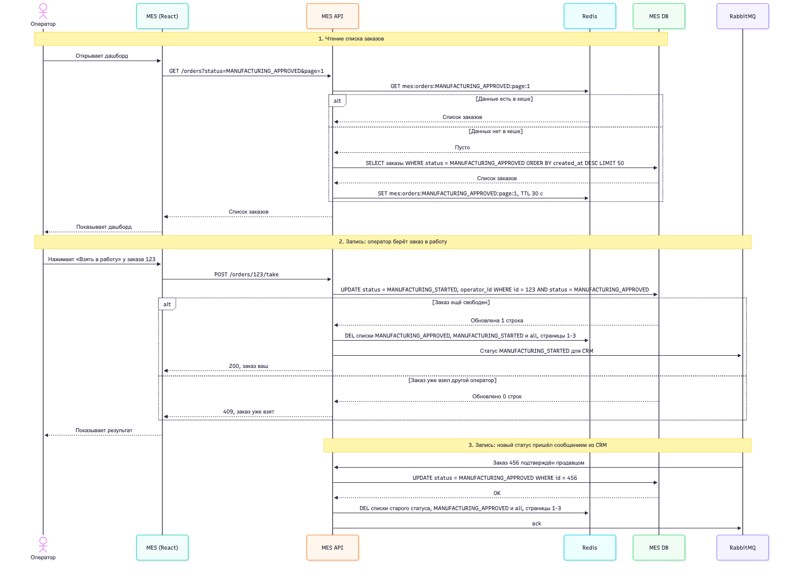

# Архитектурное решение по кешированию

## 1. Мотивация

Операторы жалуются, что первая страница MES — дашборд со списком заказов по статусам — открывается очень долго. Фильтр по статусам и пагинация не помогли.

Почему так происходит:

- **Дашборд открывают очень часто.** Кто первым взял заказ, тот и получает оплату, поэтому операторы постоянно обновляют страницу, чтобы не пропустить новый заказ. Это много одинаковых запросов «дай свежие заказы в статусе X».
- **Каждый такой запрос идёт в MES DB.** База одна, работает и на чтение, и на запись. Те же самые данные читаются из неё снова и снова, хотя между обновлениями страницы они почти не меняются.
- **MES API и так перегружен.** На том же инстансе идёт расчёт цены (2–30 минут на заказ), и тяжёлые запросы дашборда конкурируют с ним за ресурсы.

Получается типичный случай для кеша: читают часто, а меняется редко. Статус заказа меняется несколько раз за всю его жизнь, а список читают десятки операторов каждые несколько секунд.

Что даст кеширование:

- Дашборд будет отдаваться из памяти за миллисекунды, а не собираться запросом к базе каждый раз.
- Нагрузка на MES DB упадёт: в базу пойдёт только первый запрос после изменения данных.
- У MES API останется больше ресурсов на расчёт цены и запросы партнёров. Это немного помогает и со скоростью выполнения заказов, на которую жалуются новые клиенты.

**Что кешируем:**

| Что | Кешируем? | Почему |
|---|---|---|
| Список заказов на дашборде MES (по одному статусу или все, первые 3 страницы) | Да | Главная причина жалоб. Читают постоянно, меняется редко |
| Глубокие страницы списка (4-я и дальше), фильтр по нескольким статусам сразу | Нет | Их открывают редко, кеш почти не будет попадать. Достаточно индексов и keyset-пагинации из задания 1 |
| Карточка одного заказа | Нет | Запрос по первичному ключу и так быстрый |
| Результат расчёта цены | Пока нет | Можно было бы кешировать цену по хешу 3D-файла, но мы не знаем, как часто модели повторяются. Сначала посмотрим это по логам (задание 4) |
| Статика фронтендов (JS, CSS, картинки) | Да, обычным HTTP-кешем браузера | Стандартная настройка, но жалобы решает не она |

Важно: кеш не заменяет остальные доработки из задания 1. Индексы по статусу и дате и вынос расчёта цены в воркеры нужны всё равно. Кеш снимает с базы самую частую и одинаковую нагрузку.

## 2. Предлагаемое решение

### 2.1. Клиентское или серверное кеширование

Выбираем **серверное кеширование** — общий кеш в **Redis** (Managed Redis в Yandex Cloud) между MES API и MES DB.

Почему не клиентское (кеш в браузере оператора):

- **Каждый браузер кеширует сам по себе.** Если оператор А взял заказ, браузер оператора Б об этом не узнает и будет показывать заказ свободным. Сбросить чужой браузерный кеш с сервера нельзя.
- **Устаревший список — это деньги.** Оператор не видит новый заказ или видит уже занятый, а от этого зависит его вознаграждение.
- **Нагрузку на базу это почти не снимает.** Каждый оператор всё равно хотя бы раз ходит в базу за своей копией, а операторов много.

Серверный кеш один на всех: все операторы и все инстансы MES API (по целевой архитектуре их будет минимум два) видят одни и те же данные. Сбросить его можно в одном месте, сразу при изменении заказа.

### 2.2. Паттерн: Cache-Aside

Выбираем **Cache-Aside**:

- **Чтение.** MES API сначала смотрит в Redis. Если данные есть — сразу отдаёт. Если нет — читает из MES DB, кладёт результат в Redis и отдаёт.
- **Запись.** MES API пишет изменение в MES DB, а затем удаляет из Redis списки, на которые это изменение повлияло. Следующее чтение возьмёт свежие данные из базы.

| Паттерн | Как работает | Подходит ли нам |
|---|---|---|
| **Cache-Aside** | Приложение само читает из кеша, при промахе берёт из базы и кладёт в кеш. При записи сбрасывает кеш | **Подходит.** Просто сделать, в кеше только то, что реально смотрят. Если Redis упал, MES API просто читает из базы — дашборд работает, только медленнее |
| **Write-Through** | При каждой записи данные сразу пишутся и в базу, и в кеш | **Хуже.** Мы кешируем не отдельный заказ, а списки. Смена статуса одного заказа меняет два списка (старый статус и новый), а в каждом списке сдвигаются страницы. Пересобирать и записывать их на каждое изменение — сложно и дорого. К тому же статус меняют несколько мест (операторы, расчёт цены, сообщения из CRM), и все они должны правильно обновлять кеш. Удалить ключ гораздо проще и надёжнее, чем правильно его пересчитать |
| **Refresh-Ahead** | Кеш сам обновляется заранее, до истечения срока, по таймеру | **Не подходит.** Новые заказы приходят в любой момент, а не по расписанию. Между обновлениями кеш показывает старые данные, и оператор не видит свежий заказ. Плюс кеш дёргает базу постоянно, даже ночью, когда дашборд никто не смотрит |

### 2.3. Что лежит в кеше

- **Ключ:** `mes:orders:{status}:page:{n}`, где status — один из статусов или `all`, n — номер страницы от 1 до 3. Например, `mes:orders:MANUFACTURING_APPROVED:page:1`.
- **Значение:** JSON со списком заказов для дашборда (по 50 на странице, самые новые сверху): номер заказа, статус, дата создания, источник (shop / api), оператор, если заказ уже взят. Персональных данных покупателей в кеше нет, оператору они на дашборде не нужны.
- **TTL:** 30 секунд — страховка на случай, если сброс кеша не сработал (подробнее в разделе 2.5).
- **Размер:** 10 статусов + `all`, по 3 страницы — 33 ключа по несколько десятков КБ. Это единицы мегабайт, хватит самого маленького инстанса Redis.

Все изменения заказа в MES (новый заказ, смена статуса, назначение оператора) проходят через один метод в коде. В нём после записи в базу и сбрасываем кеш. Если расчёт цены вынесут в отдельные воркеры (задание 1), они используют тот же метод.

### 2.4. Диаграмма последовательности

Чтение списка заказов и запись при изменении статуса. Участники кеширования: MES API (решает, брать из кеша или из базы, и сбрасывает кеш), Redis (сам кеш), MES DB (источник правды).

.

Что важно на диаграмме:

- Кеш сбрасываем **после** успешной записи в базу, а не до неё.
- Кеш используется **только для чтения**. Решение «кто взял заказ» всегда принимает база: в UPDATE есть условие `AND status = MANUFACTURING_APPROVED`. Даже если два оператора увидели один и тот же заказ свободным, взять его сможет только один, второй получит ответ «заказ уже взят».

### 2.5. Стратегия инвалидации

Выбираем **программную инвалидацию** (код сам удаляет ключи при изменении заказа) и **TTL 30 секунд как страховку**.

Как это работает: заказ перешёл из статуса A в статус B — удаляем одной командой `DEL` 9 ключей: страницы 1–3 для A, для B и для `all`. Остальные списки не трогаем, их это изменение не касается.

| Стратегия | Как работает | Подходит ли нам |
|---|---|---|
| **Программная** (сброс в коде при изменении) | Изменили заказ — сразу удалили связанные ключи | **Основная.** Данные свежие сразу после изменения, а это главное для операторов. Удобно, потому что все изменения заказа проходят через одно место в коде |
| **Временная** (TTL) | Запись живёт N секунд, потом удаляется сама | **Только как страховка.** Если полагаться только на TTL, новый заказ появится на дашборде с опозданием до N секунд. Сделаем TTL маленьким — кеш почти перестанет работать. Но как запасной вариант TTL нужен: если сброс не сработал (сбой Redis, ошибка в коде), старые данные проживут не дольше 30 секунд |
| **По ключу** (версия или время изменения в имени ключа) | При изменении данных меняется сам ключ, например `...:v42`. Старые ключи никто не читает, они умирают по TTL | **Сложнее без пользы.** Чтобы узнать актуальную версию, нужен ещё один запрос при каждом чтении. Нам проще удалить 9 известных ключей |
| **Полный сброс** (удалить весь кеш) | Любое изменение — очищаем всё | **Не подходит.** Изменения идут постоянно, кеш почти всё время был бы пустым |

### 2.6. Риски и что с ними делаем

- **Redis недоступен.** MES API ставит короткий таймаут на обращение к Redis (100 мс) и при ошибке просто читает из базы. Дашборд работает, только медленнее.
- **Гонка чтения и записи.** Редкий случай: чтение взяло из базы старые данные, в это время прошла запись и сброс, а потом чтение положило старые данные в кеш. Такие данные проживут максимум 30 секунд (TTL). Для дашборда это допустимо, потому что взять заказ всё равно можно только через проверку в базе (см. раздел 2.4).
- **Забыли сбросить кеш в новом месте кода.** Все изменения заказа идут через один метод, это правило проверяем на код-ревью. Плюс TTL.
- **Безопасность.** Redis доступен только из внутренней сети для MES API, вход по паролю, связь по TLS. Персональных данных в кеше нет.

### 2.7. Как проверим результат

В мониторинг (задание 2) добавляем:

- долю попаданий в кеш (hit ratio) — ожидаем больше 80%;
- время ответа `GET /orders` (p95) — было несколько секунд, ждём меньше 300 мс;
- нагрузку на MES DB (CPU, количество запросов) — должна заметно упасть.

Внедряем сначала на dev и release, проверяем, что после смены статуса список на дашборде обновляется сразу. Потом выкатываем на prod.

## 3. Дополнительно: сравнение двух вариантов

Кроме Redis можно было бы кешировать прямо в памяти процесса MES API (например, `IMemoryCache` в .NET). Паттерн и инвалидация те же, меняется только место, где лежит кеш.

| | Решение 1: общий кеш в Redis | Решение 2: кеш в памяти MES API |
|---|---|---|
| Описание и диаграмма | Описано выше, диаграмма в разделе 2.4 | Та же диаграмма, только вместо Redis — память процесса MES API |
| Плюсы | Один кеш на все инстансы MES API и воркеры: сбросили в одном месте — свежие данные видят все. Кеш не пропадает при деплое и перезапуске MES API. Не занимает память MES API | Не нужна новая инфраструктура, сделать можно за день-два. Самый быстрый доступ, без сети |
| Минусы | Новый компонент: стоит денег, его нужно настроить и мониторить. Ещё один сетевой вызов (около 1 мс) | У каждого инстанса MES API свой кеш. Изменение на одном инстансе не сбрасывает кеш на другом, и там до 30 секунд висят старые данные. Воркеры расчёта цены (отдельные процессы) вообще не могут сбросить этот кеш. Кеш пропадает при каждом перезапуске. Занимает память и так перегруженного MES API |

**Вывод: выбираем Redis.** Кеш в памяти работает, пока у MES API один инстанс. Но по целевой архитектуре (задание 1) инстансов будет минимум два, а расчёт цены уедет в отдельные воркеры. Тогда кеш в памяти начнёт показывать разным операторам разные данные, а это ровно то, на что они и жалуются. Redis сразу решает задачу и на будущую архитектуру, а стоит немного: данных в кеше на единицы мегабайт.
